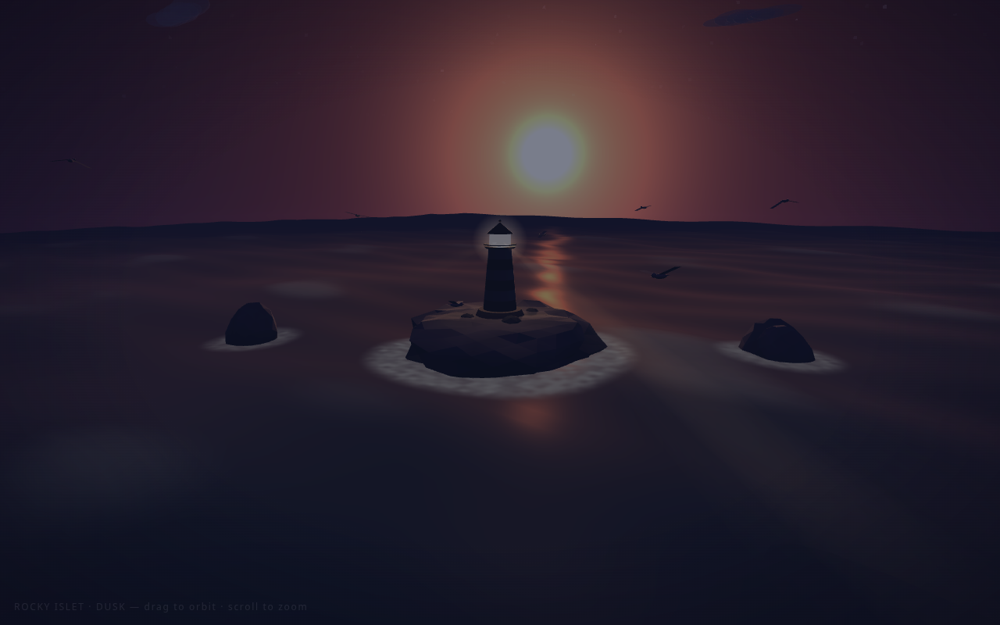
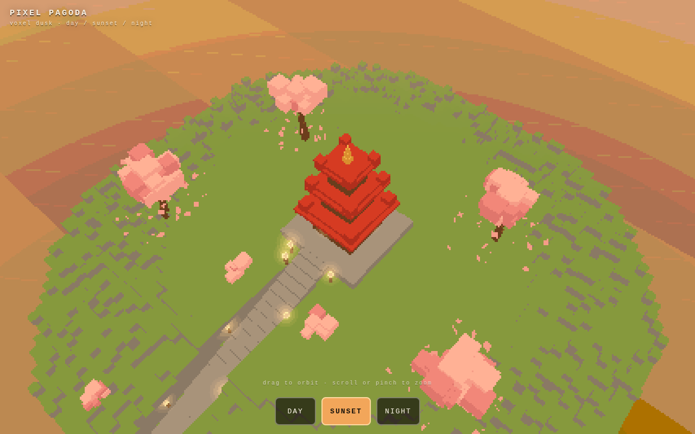

# Showcases

Single-file three.js demos written by **Ling-3.1-flash Wrench EXL3 2.10 bpw** on one R9700 (32 GB) with 192 GB of RAM.
Each is one shot from the prompt shown, with thinking on, and nothing edited: `index.html` is the model's answer byte for
byte. The model's reasoning is kept next to each demo.

| Demo | Open | Prompt | Thinking + answer tokens | Time |
|---|---|---|---:|---:|
| Lighthouse islet at dusk | [live](https://boxwrench.github.io/ling-wrench/showcase/lighthouse/) · [source](lighthouse/index.html) | [prompt](lighthouse/prompt.md) | 32,626 + 10,477 | 65 min |
| Pixel pagoda | [live](https://boxwrench.github.io/ling-wrench/showcase/pixel-pagoda/) · [source](pixel-pagoda/index.html) | [prompt](pixel-pagoda/prompt.md) | 45,678 + 10,452 | 89 min |

## How they were made

- Model: [boxwrench/Ling-3.1-flash-exl3-wrench-2.10bpw](https://huggingface.co/boxwrench/Ling-3.1-flash-exl3-wrench-2.10bpw),
  served by [`bench/serve_fast.py`](../bench/serve_fast.py) with the fast settings from the
  [Ling-3.1 page](../ling-3.1/README.md) (`-dev cuda:0 -mcl 62 -mct 8 -gcs 8192`, `EXL3_MOE_STREAM_T=6`, cache 66,560).
- Sampling: thinking on, temperature 0.7, top_p 0.95, top_k 20, seed 42; up to 64,000 new tokens. Decode ran at
  about 11 tok/s, so most of the time is the model thinking.
- One shot per prompt, no repair turns, no edits. Each folder's `run.json` has the exact settings and token counts.
- The lighthouse prompt is two sentences plus a format line; the pagoda prompt is a longer brief describing the look and
  the techniques. With thinking on, two other briefs (a water terrain and a soft-body toy) used the whole 64,000-token
  budget on reasoning and did not reach an answer, so they are not shown.
- Screenshots come from headless Chrome with software WebGL; on a real GPU they render smoother and sharper.
